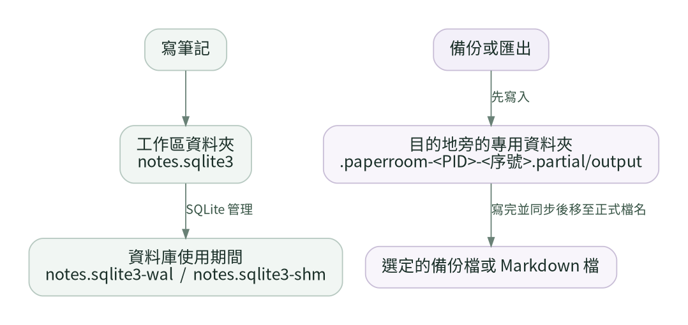
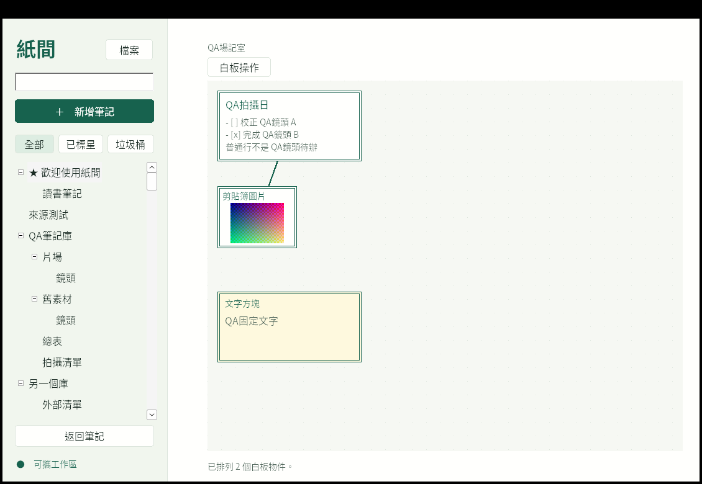
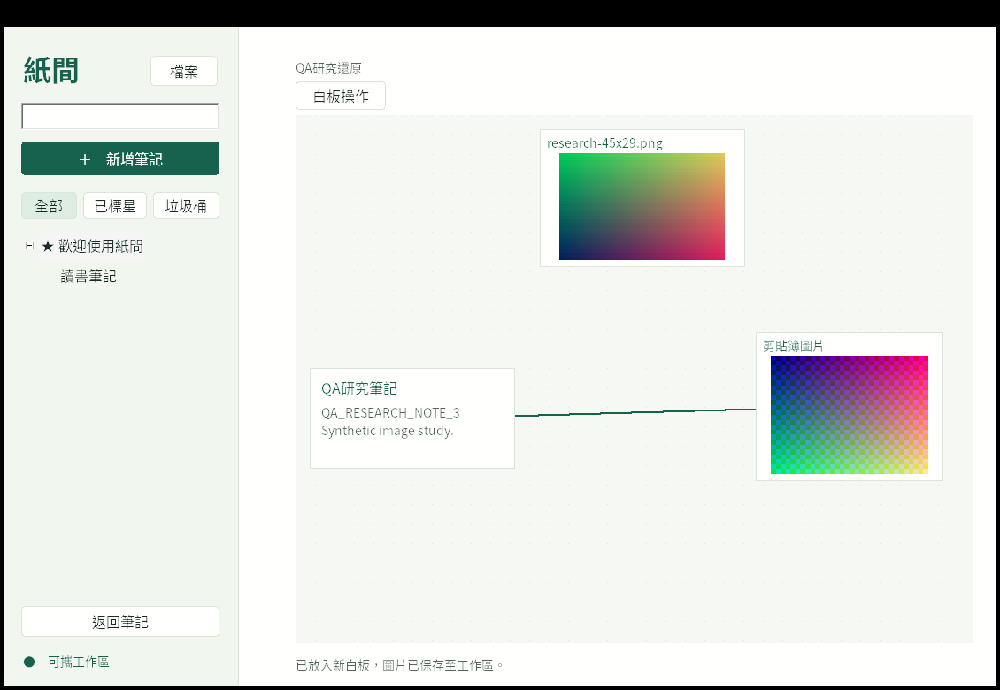
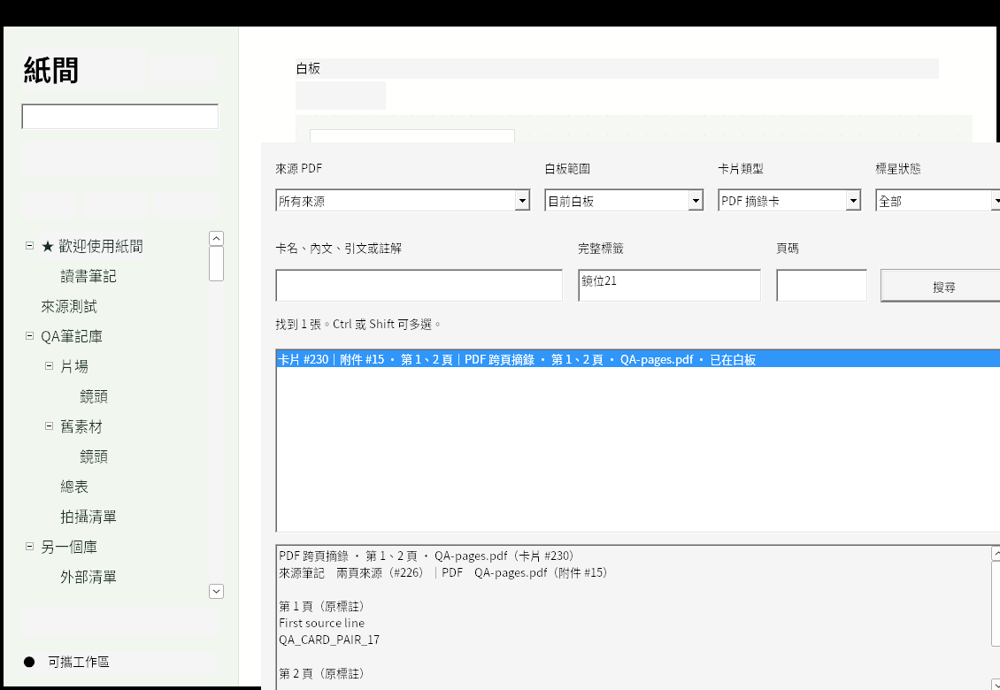
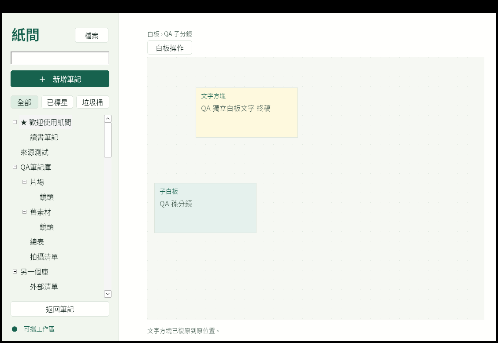

# 紙間 Paperroom

紙間是一款 Windows 本機筆記程式，使用 Rust 和 Windows 原生控制項製作。你可以建立階層筆記、用 Markdown 書寫、透過連結串接頁面，也可以在白板排列筆記卡片。筆記儲存在本機 SQLite 資料庫；程式不提供雲端同步或協作。

## 下載與開啟

1. 從本儲存庫的 Releases 下載 Windows x64 版本。若下載 ZIP，先解壓縮至你有權寫入的資料夾。
2. 在 Windows 10 或 11 的 x64 電腦上開啟 `Paperroom.exe`。首次開啟會建立「歡迎使用紙間」和示範子頁。
3. 預設筆記資料儲存在 `%LOCALAPPDATA%\Paperroom\notes.sqlite3`。在程式中選擇 **檔案 → 開啟資料所在資料夾**，可直接找到資料位置。

工作中的資料庫請放在本機磁碟；程式可離線使用，SQLite 已編入執行檔。執行檔尚未經 Authenticode 簽章，受管理電腦的執行政策可能禁止開啟。


圖為 [Windows Server 2022 的原生 MSVC 測試版](https://github.com/yung13yubabie/paperroom/actions/runs/45524897467)；擷取的是全新工作區，只有內建示範資料。

## 建立和整理筆記

| 想做的事 | 操作 |
| --- | --- |
| 新建筆記 | 按左側 **新增筆記** 或 `Ctrl+N`，輸入標題後編輯正文。 |
| 新建子頁 | 開啟上層筆記並按 **新增子頁**；在左側用三角形展開階層。 |
| 插入標題、清單、待辦、引用或程式碼 | 編輯時在空白行按 `/`，或按 **插入區塊**。 |
| 切換待辦狀態 | 在編輯模式將游標放在待辦行，選擇 **插入區塊 → 切換本行待辦狀態**。 |
| 切換閱讀與編輯 | 按 **閱讀／編輯** 或 `Ctrl+E`。 |
| 儲存 | 程式平時自動儲存，也可按 `Ctrl+S` 立即存檔。 |
| 搜尋 | 按 `Ctrl+F` 移至左側搜尋，可搜尋中文標題與正文。 |
| 標星、搬移或刪除 | 使用 **更多** 選單；誤刪後可從 **垃圾桶 → 還原** 找回。 |


## 連結和白板

選擇 **連結 → 插入筆記連結**，可在游標處加入指向另一篇筆記的連結；也可以輸入 `[[筆記標題]]`。有同名筆記時，請使用選單插入。**連結**選單也會列出目前頁面指向的筆記，以及引用目前頁面的筆記，可直接開啟。

從左下方開啟 **卡片白板**，按 **放入白板** 選擇筆記。拖曳卡片可調整位置，雙擊可開啟原筆記，右鍵可將卡片移出白板。白板會保存卡片位置。候選版也可建立多張白板、連線及分區。

## 匯入、匯出與備份

以下為此分支的候選版操作。已發布的 v0.1.1 不包含所有新選單。

- **匯入 Markdown**：選擇 **檔案 → 匯入 Markdown**，讀取 UTF-8 編碼的 `.md` 或 `.markdown` 檔案。
- **匯入 Notion**：在 Notion 匯出時選擇 **Markdown & CSV** 並勾選 **Include subpages**，再於紙間選擇 **匯入 Notion Markdown ZIP**。紙間依包內路徑建立 Markdown 頁面與子頁，保留可辨識的包內附件及原始 CSV，並列出未能匯入的項目。
- **先看 Notion CSV**：選 **檔案 → 預覽 Notion ZIP 關聯（唯讀）**，選定 ZIP 和其中一份 CSV，再選 **檢視原始 CSV**。關聯預覽需要明確的來源頁面 ID，只顯示候選結果，不會寫入工作區。匯入不會把原始 CSV 還原成 Notion 資料庫，也不會重建原有關聯或公式。
- **Heptabase 備份**：可嘗試使用 **檔案 → 匯入 Markdown ZIP（相對附件）**。紙間只讀取 Markdown 與可辨識的包內附件。它不會還原 `All-Data.json` 中的原廠白板配置、卡片關聯或備份資料。
- **匯出單篇**：選擇 **匯出目前筆記為 Markdown**。這只輸出目前頁面的文字。
- **備份整個工作區**：選擇 **備份工作區** 並使用新的檔名，可保留筆記、白板位置、標星和垃圾桶。
- **另開備份**：在另一個資料夾放一份 `Paperroom.exe`，於其旁建立 `paperroom-data` 資料夾，將備份複製到其中並命名為 `notes.sqlite3`，再開啟該處的程式。如此可在原工作區之外檢視備份。

若想使用可攜式工作區，先在執行檔旁建立空的 `paperroom-data` 資料夾。若同名項目是檔案，程式會停止啟動，不會改用其他位置，也不會更動該檔案。攜走程式和資料夾前，先正常關閉所有紙間視窗。筆記資料庫及備份為明文，請妥善保管；能存取檔案的人可以讀取內容。

## 暫存檔案與資料保護

備份或匯出時，紙間可能在目的地旁建立 `.paperroom-<PID>-<序號>.partial/` 目錄；儲存附件副本則可能建立同名格式的 `.partial` 檔案。正常完成或一般錯誤時會嘗試清理暫存；強制關閉程式可能留下它。先關閉所有紙間視窗，確認是已中斷且不需保留的作業，再刪除 該暫存目錄或檔案。

SQLite 的 WAL 和 SHM 是資料庫運作的一部分，不要手動刪除。筆記資料庫、工作區備份及尚未確認不需保留的輸出都不是可任意清除的暫存檔。

## 目前範圍

紙間支援本機筆記、白板及附件管理。候選版可匯入選定的 Obsidian Vault 或單一畫布 ZIP，也可在本機 PDF 保存標註與摘錄。紙間不會自動監看 Vault，也不提供雲端同步、多人協作或應用程式層級加密。各候選功能的驗證範圍與限制，見 [功能狀態](docs/FEATURE-STATUS.md)。

## 從原始碼建置

新的 Windows x64 候選檔使用 Rust 1.100.0 與 Visual Studio C++（MSVC）工具鏈。建置採用靜態 VC 執行階段，CI 會檢查候選 EXE 是否仍直接匯入另行安裝的 VC 執行階段 DLL。此檢查不能取代乾淨 Windows 客戶端的斷網實測，也不等於完成再散布清單。

在已安裝上述 MSVC 工具鏈的 Windows 環境執行：

```powershell
cargo build --locked --release --target x86_64-pc-windows-msvc
```

Windows GNU 工具鏈可供開發與交叉編譯；它不是上述 MSVC 候選檔的建置方式：

```powershell
cargo build --locked --release --target x86_64-pc-windows-gnu
```

原交付使用 Rust 1.100.0。交叉編譯需要安裝相同的 Rust 目標與 MinGW-w64，並將 `x86_64-w64-mingw32-gcc` 設為連結器和 SQLite 的 C 編譯器。Linux 可執行 `cargo test --locked` 驗證資料層；它不能取代 Windows 圖形介面的實測。

資料位置、暫存與中斷後處理請參考 [資料與離線使用](docs/STATE.md)。

更多細節請參考 [防禦性檢查](docs/AUDIT.md)、[簡易教學](docs/QUICKSTART.md)、[驗證紀錄](docs/VERIFICATION.md)及[官方公開文件索引](docs/PUBLIC-FEATURE-INDEX.tsv)。



下一版的 [Windows 簽章準備](docs/SIGNING.md) 說明候選檔的來源、審核與簽章後驗證方式；依賴、字型和圖片的來源見 [再散布清單](docs/REDISTRIBUTION.md)。

## 開發中的離線工作區

這批候選可複製單篇筆記或整個使用中的分支，保留正文、屬性及附件。在匯入 Notion Markdown ZIP 時，可以另存同包的原始 CSV。兩項功能沿用第 23 版工作區格式。[操作步驟](docs/UI-ACCEPTANCE.md#複製筆記與-notion-交接)

工作區第 23 版可匯入 Zotero CSL JSON 書目並保存原始檔。HTML ZIP 解壓後可直接在瀏覽器閱覽筆記、下載原始 Markdown 及附件。白板也可建立心智圖分支。請先用現行版本備份，再以副本開啟候選。[操作步驟](docs/UI-ACCEPTANCE.md#書目html-匯出與心智圖)

長筆記可按 F8，依標題層級與行號跳到原文。編輯中也會列出尚未存檔的新標題。匯出的 HTML 篇頁有可點擊的「本篇目錄」。[操作步驟](docs/UI-ACCEPTANCE.md#長筆記大綱與離線目錄)

從「更多 → 檢視與還原版本」可先比較目前文字與舊版，再決定是否還原。還原前的標題和正文會留在版本歷史。[操作步驟](docs/UI-ACCEPTANCE.md#筆記版本差異與還原)

匯出的 Vault ZIP 可一併保存有明確來源的圖片和附件。解壓後可在其他 Markdown 工具讀取，也可回匯到紙間的另一個批次。[資料夾與附件往返](docs/UI-ACCEPTANCE.md#vault-資料夾與附件往返)

這批候選加入同步區塊、Vault 文字嵌入及日誌月曆。在閱讀模式可查看引用內容，從「管理本篇同步區塊」可開啟或修改原文。日誌月曆用日期找回日誌，即使標題已改名。資料庫結構維持第 22 版，試用前仍建議另存工作區備份。[操作步驟](docs/UI-ACCEPTANCE.md#同步區塊vault-嵌入與日誌月曆)

第 22 版工作區候選加入白板對齊、等距及一次復原。研究 ZIP 的 Canvas 圖片路徑可保留繁中檔名。具名檢視可使用本機的週、月區間，並複製或調整同層篩選條件。也可查看 Vault 未連結提及，以及從跨頁待辦直接回到原筆記。升級前請先用現行版本備份。[候選操作及限制](docs/UI-ACCEPTANCE.md#第-22-版候選)



第 21 版工作區候選可從剪貼簿貼上圖片像素，也能另行貼上檔案總管複製的本機 PNG 或 JPEG。圖片放上白板後可移動、調整大小及連線。研究白板可匯出含圖片的 Canvas ZIP。這版也加入多層範本子頁、具名檢視的相對日期，以及 Vault 標籤排序。升級前請先用現行版本備份。[候選操作及限制](docs/UI-ACCEPTANCE.md#第-21-版候選)



第 20 版工作區候選可從空白建立範本，套用時可另外帶入已選的直接子頁。Vault 可核對搬移後的相對連結，也能搜尋及複製區塊連結。卡片資料庫可搜尋筆記卡與 PDF 摘錄卡。升級前請先備份，再以副本測試。[候選操作與限制](docs/UI-ACCEPTANCE.md#第-20-版候選)



第 19 版工作區候選可在範本中選用關聯和附件。核對 Vault 外部搬移時，會再驗證受影響的區塊引用。白板新增 PDF 摘錄卡資料庫，可依來源篩選後整批放入既有卡片。升級前請用目前版本備份，再以副本測試。[操作步驟](docs/UI-ACCEPTANCE.md#第-19-版的範本資源vault-搬移與-pdf-摘錄卡庫)

第 18 版工作區候選可從資料列保存範本，再建立獨立筆記。Vault 區塊可先預覽再前往，並返回來源筆記。白板可指定目的地後拖曳卡片跨板。升級前請用目前版本備份，再以副本測試。[操作步驟](docs/UI-ACCEPTANCE.md#第-18-版的資料列範本區塊返回與跨板拖曳)

第 17 版工作區候選可依公式、關聯和彙總結果篩選集合。匯入的 Vault 連結可跳到帶區塊 ID 的原文，白板則可將選取的卡片連同相對位置搬到另一張白板。升級前請用目前版本備份，再以副本測試。[操作步驟](docs/UI-ACCEPTANCE.md#第-17-版的衍生篩選區塊與跨板搬移)

第 16 版工作區候選可在具名集合檢視保存巢狀篩選，從 Vault 連結跳到指定的父子標題，也能將一批筆記卡或 PDF 摘錄卡放到另一張白板供兩處共用。請先用現行版本備份，再用副本開啟候選。[操作步驟](docs/UI-ACCEPTANCE.md#第-16-版的篩選標題與跨板卡片)

第 15 版工作區候選可直接在集合時間軸拖曳調整日期。確認 Vault 外部搬移時，可以一起更新已綁定的 Canvas 檔案節點。PDF 相鄰兩頁可摘成一張卡，從白板可回到兩頁原選區。升級前請用現用版本另存工作區備份。[操作步驟](docs/UI-ACCEPTANCE.md#第-15-版的時間軸vault-與雙頁摘錄)

第 13 版工作區候選可保存集合的多日事件、排序及篩選，並從所匯入的 Vault 瀏覽巢狀標籤。白板能復原最近移除的文字方塊。若原 PDF 仍在，也能從摘錄卡復原標註與選區。請用現行紙間備份工作區，再用副本測試新版。

這份開發分支也可複製具名檢視、在備份後更新同一路徑的 Vault 附件，並從不同白板開啟同一張 PDF 摘錄。原標註移除後，只要原 PDF 仍可開啟，就能預覽選區。[這批操作與驗收](docs/UI-ACCEPTANCE.md#清除建置路徑的第-13-版候選)

上一批本機候選可從集合檢視操作關聯，以原始 Vault 路徑開啟匯入筆記，並在閱讀順序明確的同頁雙欄 PDF 保存文字選區。[這批操作與驗收](docs/UI-ACCEPTANCE.md#集合關聯vault-瀏覽與-pdf-雙欄候選) · [發版前檢查](docs/VERIFICATION.md#公開前核對本機候選)

第 14 版工作區候選加入月時間軸、Vault 外部搬移核對、白板混合多選，以及 PDF 相鄰兩頁選取。[這批操作與驗收](docs/UI-ACCEPTANCE.md#第-14-版的排程來源維護與選區操作)



圖為第 13 版工作區候選在無網卡 Wine 環境的實際畫面，使用合成筆記。狀態列顯示文字方塊已復原至原位置。

[整合範圍、REA 證據與驗收案例](docs/INTEGRATION-COVERAGE.md) · [第二階段操作與限制](docs/WORKSPACE-SECOND-STAGE.md) · [介面入口與驗收紀錄](docs/UI-ACCEPTANCE.md) · [三款工具功能狀態](docs/FEATURE-STATUS.md)
