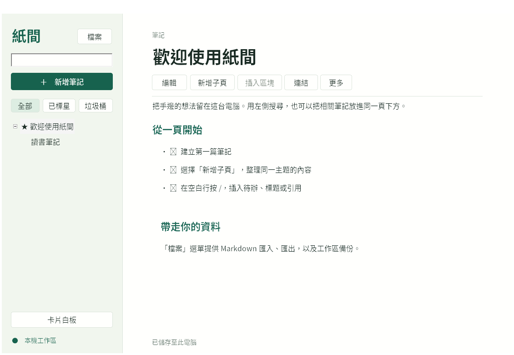
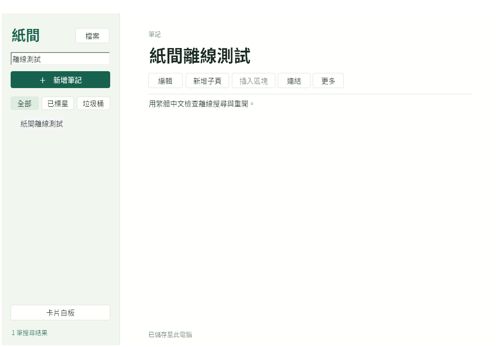

# 紙間 Paperroom

紙間是一款 Windows 本機筆記程式，使用 Rust 和 Windows 原生控制項製作。你可以建立階層筆記、用 Markdown 書寫、透過連結串接頁面，也可以在白板排列筆記卡片。筆記儲存在本機 SQLite 資料庫；程式不提供雲端同步或協作。

## 下載與開啟

1. 從本儲存庫的 Releases 下載 Windows x64 版本。若下載 ZIP，先解壓縮至你有權寫入的資料夾。
2. 在 Windows 10 或 11 的 x64 電腦上開啟 `Paperroom.exe`。首次開啟會建立「歡迎使用紙間」和示範子頁。
3. 預設筆記資料儲存在 `%LOCALAPPDATA%\Paperroom\notes.sqlite3`。在程式中選擇 **檔案 → 開啟資料所在資料夾**，可直接找到資料位置。

工作中的資料庫請放在本機磁碟；程式可離線使用，SQLite 已編入執行檔。執行檔尚未經 Authenticode 簽章，受管理電腦的執行政策可能禁止開啟。



圖中是 v0.1.1 在斷網的 Wine 10 測試環境中首次啟動的畫面。測試使用 Noto Sans CJK TC 顯示繁體中文。

## 建立和整理筆記

| 想做的事 | 操作 |
| --- | --- |
| 新建筆記 | 按左側 **新增筆記** 或 `Ctrl+N`，輸入標題後編輯正文。 |
| 新建子頁 | 開啟上層筆記並按 **新增子頁**；在左側用三角形展開階層。 |
| 插入標題、清單、待辦、引用或程式碼 | 編輯時在空白行按 `/`，或按 **插入區塊**。 |
| 切換待辦狀態 | 在編輯模式將游標放在待辦行，選擇 **插入區塊 → 切換本行待辦狀態**。 |
| 切換閱讀與編輯 | 按 **閱讀／編輯** 或 `Ctrl+E`。 |
| 儲存 | 程式平時自動儲存，也可按 `Ctrl+S` 立即存檔。 |
| 搜尋 | 按 `Ctrl+F` 移至左側搜尋，可搜尋中文標題與正文。 |
| 標星、搬移或刪除 | 使用 **更多** 選單；誤刪後可從 **垃圾桶 → 還原** 找回。 |



## 連結和白板

選擇 **連結 → 插入筆記連結**，可在游標處加入指向另一篇筆記的連結；也可以輸入 `[[筆記標題]]`。有同名筆記時，請使用選單插入。**連結**選單也會列出目前頁面指向的筆記，以及引用目前頁面的筆記，可直接開啟。

從左下方開啟 **卡片白板**，按 **放入白板** 選擇筆記。拖曳卡片可調整位置，雙擊可開啟原筆記，右鍵可將卡片移出白板。白板保存卡片位置；目前沒有卡片連線、群組或多張白板。

## 匯入、匯出與備份

- **匯入 Markdown**：選擇 **檔案 → 匯入 Markdown**，讀取 UTF-8 編碼的 `.md` 或 `.markdown` 檔案。
- **匯入 Notion**：在 Notion 匯出時選擇 **Markdown & CSV** 並勾選 **Include subpages**，再於紙間選擇 **匯入 Notion Markdown ZIP**。紙間依 ZIP 內的路徑建立頁面與子頁，並回報略過的項目。CSV 資料庫、附件及連結重映射目前不支援。
- **匯出單篇**：選擇 **匯出目前筆記為 Markdown**。這只輸出目前頁面的文字。
- **備份整個工作區**：選擇 **備份工作區** 並使用新的檔名，可保留筆記、白板位置、標星和垃圾桶。
- **另開備份**：在另一個資料夾放一份 `Paperroom.exe`，於其旁建立 `paperroom-data` 資料夾，將備份複製到其中並命名為 `notes.sqlite3`，再開啟該處的程式。如此可在原工作區之外檢視備份。

若想使用可攜式工作區，先在執行檔旁建立空的 `paperroom-data` 資料夾。攜走程式和資料夾前，先正常關閉所有紙間視窗。筆記資料庫及備份為明文，請妥善保管；能存取檔案的人可以讀取內容。

## 暫存檔案與資料保護

備份或匯出時，程式才會在目的地旁建立專用的 `.paperroom-<PID>-<序號>.partial/` 目錄，暫存檔名為 `output`。正常完成或發生錯誤時會嘗試清理；強制結束時可能留下該目錄。若要清理，先關閉所有紙間視窗，確認它是中斷作業的輸出且不需留存，才刪除整個 `.partial` 目錄。

SQLite 的 WAL 和 SHM 是資料庫運作的一部分，不要手動刪除。筆記資料庫、工作區備份及尚未確認不需保留的輸出都不是可任意清除的暫存檔。

## 目前範圍

紙間提供基本 Markdown 編輯、階層筆記、搜尋、內部連結、反向連結、垃圾桶和單一白板。它不直接開啟或監看 Obsidian Vault，也不提供版本歷史、附件管理、雲端同步、多人協作或應用程式層級加密。完整功能範圍與限制見 [功能對照](docs/FEATURES.md)。

## 從原始碼建置

Windows 開發者可安裝 Rust 及 Windows GNU 工具鏈，再執行：

```powershell
cargo build --locked --release --target x86_64-pc-windows-gnu
```

原交付使用 Rust 1.100.0。交叉編譯需要安裝相同的 Rust 目標與 MinGW-w64，並將 `x86_64-w64-mingw32-gcc` 設為連結器和 SQLite 的 C 編譯器。Linux 可執行 `cargo test --locked` 驗證資料層；它不能取代 Windows 圖形介面的實測。

資料位置、暫存與中斷後處理請參考 [資料與離線使用](docs/STATE.md)。

更多細節請參考 [防禦性檢查](docs/AUDIT.md)、[簡易教學](docs/QUICKSTART.md)、[驗證紀錄](docs/VERIFICATION.md)及[官方公開文件索引](docs/PUBLIC-FEATURE-INDEX.tsv)。


下一版的 [Windows 簽章準備](docs/SIGNING.md) 說明候選檔的來源、審核與簽章後驗證方式；依賴、字型和圖片的來源見 [再散布清單](docs/REDISTRIBUTION.md)。
