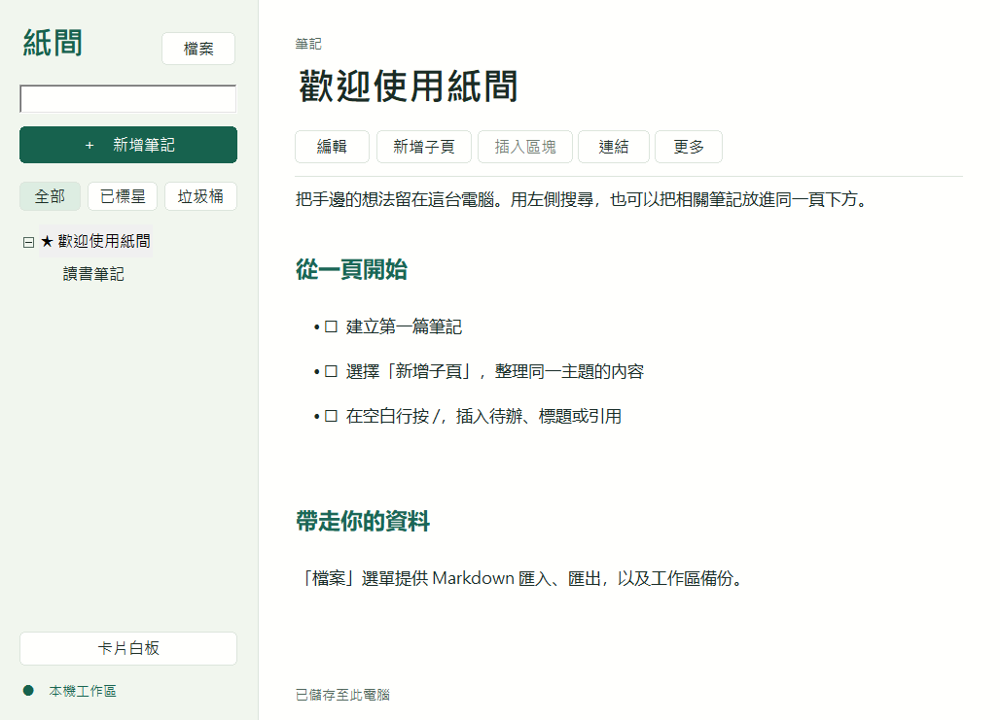

# 紙間簡易教學

本頁的匯入與 PDF 步驟適用於此分支的候選版。已發布的 v0.1.1 可能沒有這些選單。

## 第一次打開

1. 把 ZIP 解壓縮到一個你能寫入的資料夾。
2. 在 **Windows 10／11 x64** 雙擊 `Paperroom.exe`。若成功開啟，首次會出現「歡迎使用紙間」和示範子頁。
3. 資料預設存到 `%LOCALAPPDATA%\Paperroom\notes.sqlite3`。可從程式選擇 **檔案 → 開啟資料所在資料夾**。

紙間採單一執行檔與本機儲存設計，不依賴雲端同步。候選版的啟動測試在 Windows Server 持續整合環境執行，尚未在乾淨且斷網的 Windows 10／11 電腦實測。執行檔尚未做 Authenticode 簽章，受管電腦的執行政策可能禁止開啟。

首次開啟時，左側是筆記清單，右側是內建歡迎筆記；下方顯示「已儲存至此電腦」。這張圖拍攝於原生 Windows Server 測試，未代表乾淨斷網的 Windows 10／11 已驗收。

## 寫一頁筆記

| 你想做什麼 | 操作 |
| --- | --- |
| 新建筆記 | 左側 **新增筆記** 或 `Ctrl+N`。先輸入標題，再點正文編輯。 |
| 新建子頁 | 開啟上層筆記，按 **新增子頁**。左欄用三角形展開。 |
| 寫標題、待辦、引用、程式碼 | 編輯時在空白行按 `/`，或按 **插入區塊**。 |
| 勾選已完成的待辦 | 在編輯模式將游標放在待辦行，再選 **插入區塊 → 切換本行待辦狀態**。 |
| 切換閱讀與編輯 | 按 **閱讀／編輯** 或 `Ctrl+E`。 |
| 儲存 | 平時自動儲存，可按 `Ctrl+S` 立即存檔。 |
| 搜尋 | `Ctrl+F` 將焦點移到左欄搜尋，支援中文標題和正文。 |
| 全域搜尋與 PDF 標註 | 按 `Ctrl+Shift+F` 搜尋筆記。要找引文或註解，勾選 **搜尋 PDF 標註**，再開啟命中項目以定位來源頁。 |
| 標星、搬移、刪除 | 從 **更多** 選擇。誤刪可到 **垃圾桶 → 還原**。 |

## 把筆記串起來

- 從 **連結 → 插入筆記連結** 選一篇。應用程式會在游標位置加入連結。也可以直接輸入 `[[筆記標題]]`。同名筆記請用選單插入。
- **連結** 選單列出目前頁指向的筆記，以及有哪些筆記引用這一頁。從選單直接開啟對應的頁面。
- 從左下開啟 **卡片白板**，按 **放入白板** 選筆記。拖曳排列，雙擊卡片打開原頁，右鍵可把卡片移出白板。

## 匯入與備份

- 從 **檔案 → 匯入 Markdown** 可讀取 UTF-8 的 `.md` 或 `.markdown`。
- 在 Notion 選 **Markdown & CSV** 並勾選 **Include subpages**。回到紙間從 **檔案 → 匯入 Notion Markdown ZIP** 選取 ZIP。紙間保留 Markdown 頁面階層、可辨識的包內附件和 CSV 原檔。
- **前往原始頁面**。從匯入的頁面開啟 **筆記連結**，選 **前往**。選單會顯示原始路徑，可區分不同資料夾的同名頁。紙間只解析同次匯入、同一 ZIP 部件內與原始路徑及大小寫相符的頁面。片段若符合唯一的字面標題，就會定位到該處。其餘片段會開啟筆記並說明結果。外部網址、附件和無法配對的路徑留在原文。舊匯入若缺少來源路徑，可以另行匯入原 ZIP。
- **將 CSV 建成集合**。在 **Notion 原始 CSV** 選一份來源筆記，依序選 **更多 → 附件與 PDF 摘錄 → 管理附件**，再選 CSV 及 **從 Notion CSV 建立新集合**。每個集合最多 1,000 列。第一欄作為筆記標題，欄值可從列筆記的 **更多 → 設定文字屬性** 編輯。遇到同名集合、既有非文字屬性同名、格式錯誤或超出上限時，會顯示原因。原始 CSV 可另存，Notion 的公式、關聯與檢視需自行重建。
- **只看 CSV**。選 **檔案 → 預覽 Notion ZIP 關聯（唯讀）**，選取 ZIP 和其中一份 CSV，再選 **檢視原始 CSV**。若選 **預覽關聯**，CSV 必須含有明確的來源頁面 ID。
- **Heptabase**：從 **檔案 → 匯入 Markdown ZIP（相對附件）** 可嘗試匯入 Markdown 與可辨識的包內附件。這個入口不會讀取 `All-Data.json` 內容，也不會還原原廠白板配置或卡片關聯。
- **匯出目前筆記為 Markdown** 產生文字檔。若要保留整個工作區、白板位置、標星與垃圾桶，選 **備份工作區** 並使用新的檔名。
- 從整份備份另開：選 **檔案 → 從備份另開可攜工作區…**，選取備份檔和本機上層資料夾，再為新資料夾命名。確認後，紙間複製目前的程式並另開還原的工作區。新資料夾必須尚未存在。原視窗保留原有資料，複製的程式也會保留 Windows 來源標記。若 Windows 未開啟副本，可從新資料夾開啟其中的程式。支援用「備份工作區」建立、資料結構為第 43 或 44 版的獨立備份。
- 想把新工作區放在隨身碟，也可以先在執行檔旁建立空的 `paperroom-data` 資料夾。帶走程式與該資料夾前，先正常關閉所有紙間視窗。

## 帶走 Canvas 與本機附件

1. 把 `.canvas` 與它引用的本機檔案放在同一資料夾或其子資料夾，保持原本的相對路徑與檔名大小寫。選 **檔案 → 匯入 JSON Canvas 與同資料夾附件**，再選 `.canvas`。
2. 預覽會列出可保存、缺少或無法配對的附件。取消會回到原工作區；確認才建立副本。群組背景、檔案卡附件與畫布會一起保存，來源檔案維持原樣。
3. 從 **Canvas 操作 → 匯出 JSON Canvas ZIP** 把畫布和已保存的附件一起帶走。另一份工作區可用 **檔案 → 匯入 JSON Canvas ZIP** 開啟。

「匯入 JSON Canvas 與同資料夾附件」從畫布所在資料夾解析路徑。若 Obsidian 畫布放在 Vault 的子資料夾，請改用 **檔案 → 從 Obsidian Vault 匯入 Canvas**。先選 Vault 根目錄，再選其中的 `.canvas`。這個入口會從選定的根目錄精確找檔案卡與群組背景。同名檔案放在畫布旁時，仍以根目錄內的指定相對路徑為準。預覽會標明缺少或大小寫歧義的參照，原始 JSON 保留這些路徑。 [Obsidian Canvas API](https://github.com/obsidianmd/obsidian-api/blob/master/canvas.d.ts)

這兩個入口建立的 Canvas ZIP 將畫布放在 ZIP 最外層，附件沿用相對路徑。原始 Vault 與畫布位置維持原狀。紙間會保留遠端連結和無法繪製的節點原文。上層路徑、符號連結、重新分析點和其他 `.canvas` 檔不會包入 ZIP，也不會主動下載遠端檔案。單一附件上限 16 MiB。畫布與附件合計上限 128 MiB。

## 從 PDF 標註回到原文

1. 開啟已有 PDF 附件的筆記，選 **更多 → 附件與 PDF 摘錄 → 管理附件**。選取 PDF 後按 **開啟 PDF 頁面並標註**。
2. 在有文字層的頁面，選 **PDF 操作 → 選取 PDF 文字**，拖曳要保存的文字，再選 **保存文字標註**。
3. 從 **PDF 操作 → 從本頁標註建立摘錄卡** 選擇剛保存的標註和白板。打開摘錄卡後，按 **更多 → 開啟 PDF 摘錄來源** 回到原頁和選區。原 PDF 需要仍可開啟；掃描圖片不會自動辨識成文字。

其他限制與各版本驗收紀錄見 [功能狀態](FEATURE-STATUS.md)。

## 標示筆記文字

先儲存筆記，在編輯模式選取單行段落中的純文字，再從「更多」選「切換選取文字的螢光標記」。切回閱讀模式即可看到標記。同一範圍可再次切換，也可在編輯模式清除本篇標記。程式會拒絕連結、程式碼及其他不支援的選取位置。

工作區與 SQLite 備份會保存這些標記，工作區 HTML ZIP 也會顯示。Markdown 原稿不加任何符號，原有的 `==文字==` 仍照原樣顯示。正文改動時會清除舊位置的標記，避免標到其他文字。
